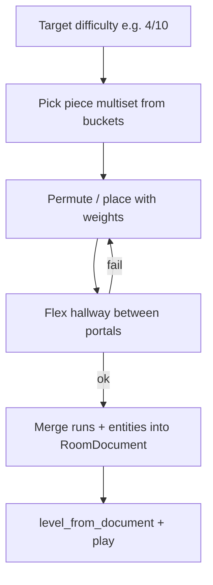

# Room generation from level pieces

Status: **deferred** — piece authoring is done; stitcher / flex / `generate_room` not started.
Canonical tracked copy (git). Cursor agent plan may mirror this.

## Goal

**Done:** author a library of obstacle **pieces** with a strong editor (portals, tags, playtest). Play continues on hand-made rooms (`assets/levels/demo.json`).

**Later:** at room load, stitch pieces into a `RoomDocument` for a target difficulty (e.g. 4/10) with weighted picks and procedural flex between opposite exit→entry openings.



---

## What exists today (tie-in)

| Concept | Code |
|---------|------|
| Piece schema | `src/level/piece_document.ts` — `PieceDef`, `PiecePortal`, `MIN_APERTURE_H/W` |
| Piece IO | `src/level/piece_io.ts` — `normalize_piece`, `load_piece_document`, `save_piece_document`, `load_piece_index` |
| Piece → room (playtest only) | `piece_to_room_document(piece)` → `RoomDocument` with `id = "piece_" + piece.id` (skips auto border walls in `level_from_document`) |
| Room schema | `src/level/room_document.ts` — **no** portals / difficulty / tags |
| Library on disk | `assets/pieces/*.json` + `index.json` (Vite publicDir) |
| Caps | normal pieces tagged `"cap_start"` / `"cap_end"` (e.g. `cap_start.json`) |
| Editor | Room \| Piece hub, portals, ghost overlay, playtest via World |

**Not implemented:** stitcher, flex generator, budget sampler, `generate_room`, seeded `rng.ts`.

### Actual `PieceDef` shape

```python
# Mirrors src/level/piece_document.ts

PortalFacing = Literal["left", "right", "up", "down"]

@dataclass
class TilePoint:
    x: int  # tile coords
    y: int

@dataclass
class PiecePortal:
    a: TilePoint
    b: TilePoint
    facing: PortalFacing  # outward normal of the mouth

@dataclass
class PieceDef:
    version: int                 # PIECE_DOCUMENT_VERSION = 1
    id: str
    cols: int
    rows: int
    difficulty: int              # 1–10
    tags: list[str]              # "cap_start", "gap", "from_selection", …
    entry: PiecePortal
    exit: PiecePortal
    spawn: dict                  # {x, y} pixels — playtest spawn
    layers: list                 # TerrainLayer[] (same as RoomDocument)
    entities: list               # EntityDef[]
    unique: bool | None = False

@dataclass
class RoomDocument:
    version: int                 # ROOM_DOCUMENT_VERSION = 1
    id: str
    cols: int
    rows: int
    spawn: dict                  # {x, y} pixels
    layers: list
    entities: list
    # NO entry/exit/difficulty/tags — those stay on PieceDef
```

Today the only composition path is playtest:

```python
# already in piece_document.ts
def piece_to_room_document(piece: PieceDef) -> RoomDocument:
    return RoomDocument(
        version=1,
        id=f"piece_{piece.id}",   # disables auto L/R/floor borders
        cols=piece.cols,
        rows=piece.rows,
        spawn=piece.spawn,
        layers=copy(piece.layers),
        entities=copy(piece.entities),
    )
```

---

## Piece format / portals

A piece is a **mini room** plus portal metadata. Portals are **openings** (segment + facing), not single cells — stitch needs aperture size so floors/ceilings can morph.

**Compatibility:** `A.exit` connects to `B.entry` only when facings are opposite:

| `A.exit.facing` | Compatible `B.entry.facing` | Flex axis |
|-----------------|----------------------------|-----------|
| `right` | `left` | +X hallway |
| `left` | `right` | −X hallway |
| `down` | `up` | +Y shaft |
| `up` | `down` | −Y shaft |

```python
OPPOSITE = {"left": "right", "right": "left", "up": "down", "down": "up"}

def portals_compatible(exit_p: PiecePortal, entry_p: PiecePortal) -> bool:
    return OPPOSITE[exit_p.facing] == entry_p.facing

# Soft checks already in validate_piece_portals(piece):
#   portal_length(p) >= portal_min_aperture(facing)   # MIN_APERTURE_H=4, MIN_APERTURE_W=3
#   segment on outer border, axis matches facing
```

Mouth size/position need **not** match; the stitcher inserts a **flex span** that morphs A's exit aperture into B's entry. Zero-length flex only when segments already match after translation.

### Flex span (procedural corridor / shaft) — deferred

```
A [exit]  ==== flex span ====  [entry] B
```

| Mismatch | How flex smooths it |
|----------|---------------------|
| Aligned, same aperture | Straight hallway/shaft, length `FLEX_LEN` (e.g. 2–4 tiles) |
| Lateral shift | Stepped floor/ceiling or side walls (≤1 tile step per slice) |
| Wider ↔ skinnier | Aperture lerps along the flex axis |
| Both | Per-slice clear-rect interpolated between portal endpoints |

**Rules:** clear band ≥ `MIN_APERTURE_*`; lengthen flex instead of steepening; flex difficulty `0`; no entities in flex v1.

---

## Difficulty buckets and target 4/10

**Buckets:** group library by `PieceDef.difficulty` (or ranges: 1–2 mild, 3–4 medium, 5–7 hard, 8–10 nasty). Caps are filtered by tags, not by difficulty.

```python
@dataclass
class RoomGenRequest:
    seed: int
    target_difficulty: int          # 1–10, e.g. 4
    piece_count: tuple[int, int]    # (min, max) gameplay pieces excl. caps
    tags_any: list[str] | None = None
    tags_none: list[str] | None = None
```

**Budget (default):**

1. Choose `n` in `[min, max]` (favor middle).
2. Sample difficulties `d[1..n]` with `round(mean(d)) ≈ target` (fat left tail — few high, many low).
3. For each `d_i`, pick a piece from that bucket (tag prefs, avoid immediate `id` repeat; honor `unique`).

Elite later = higher `target_difficulty` and/or shorter flex — **not** geometric ×1.5.

---

## Generator algorithm (Python pseudocode, future)

Modules that don't exist yet (suggested under `src/gen/`):

| Module | Role |
|--------|------|
| `src/rng.ts` | seeded RNG (Stage 3) |
| `src/gen/budget.ts` | difficulty multiset + weighted piece pick |
| `src/gen/flex.ts` | corridor/shaft between opposite portals |
| `src/gen/stitch.ts` | place pieces, insert flex, merge |
| `src/gen/generate_room.ts` | `generate_room(req, library) → RoomDocument` |

Reuse existing: `load_piece_index` / `load_piece_document`, `level_from_document`, `TILE` from `src/level/tiles.ts`.

```python
# --- library ---------------------------------------------------------------

def load_library() -> list[PieceDef]:
    """Like load_piece_index() then load_piece_document(id) for each entry."""
    index = load_piece_index()          # GET /pieces/index.json
    return [load_piece_document(e.id) for e in index.pieces]

def find_cap(library: list[PieceDef], tag: str) -> PieceDef:
    return next(p for p in library if tag in p.tags)

def bucket(library: list[PieceDef], d: int) -> list[PieceDef]:
    return [
        p for p in library
        if p.difficulty == d
        and "cap_start" not in p.tags
        and "cap_end" not in p.tags
    ]

# --- budget ----------------------------------------------------------------

def sample_difficulties(rng, target: int, n: int) -> list[int]:
    """
    Draw n values in 1..10 with P(k) ∝ exp(-α * |k - target|),
    extra downweight on k >> target. Retry until round(mean) ≈ target.
    """
    ...

def pick_piece(rng, candidates: list[PieceDef], used: set[str]) -> PieceDef | None:
    pool = [p for p in candidates if not (p.unique and p.id in used)]
    # weight by tags / cooldown; None if empty
    ...

# --- portals / placement ---------------------------------------------------

@dataclass
class Placed:
    piece: PieceDef
    ox: int   # tile offset into the assembled room
    oy: int

def exit_world(placed: Placed) -> PiecePortal:
    """Translate piece.exit segment by (ox, oy)."""
    e = placed.piece.exit
    return PiecePortal(
        a=TilePoint(e.a.x + placed.ox, e.a.y + placed.oy),
        b=TilePoint(e.b.x + placed.ox, e.b.y + placed.oy),
        facing=e.facing,
    )

def place_after(A: Placed, B: PieceDef, flex_len: int, lateral: int) -> Placed:
    """
    Sit B along A.exit.facing, `flex_len` tiles of corridor between mouths,
    plus `lateral` offset on the perpendicular axis (floor height / side shift).
    """
    ...

def piece_rects_overlap(a: Placed, b: Placed) -> bool:
    """AABB of piece bodies only (flex spans ignored)."""
    ...

# --- flex ------------------------------------------------------------------

def flex_length(rng, d_lateral: int, d_aperture: int) -> int:
    """
    Base FLEX_LEN_MIN..FLEX_LEN_MAX; grow so |d_lateral| steps
    never exceed 1 tile per slice along the span.
    """
    need = abs(d_lateral)  # 1 step per slice
    return max(FLEX_LEN_MIN, min(FLEX_LEN_MAX, max(need, rng.pick_base())))

def generate_flex(exit_world: PiecePortal, entry_local: PiecePortal,
                  B: Placed, length: int) -> list:
    """
    Return TerrainLayer runs (no entities) that clear a morphing aperture
    from exit_world → B.entry translated to world. Difficulty 0.
    Uses MIN_APERTURE_H / MIN_APERTURE_W from piece_document.ts.
    """
    ...

# --- merge → RoomDocument --------------------------------------------------

def translate_runs(runs, ox: int, oy: int):
    """TileRun = [row, x0, x1, kind, z?, solidFlag?] → row+oy, x0+ox, x1+ox."""
    ...

def translate_entities(entities, ox: int, oy: int):
    """EntityDef.x/y are pixels → += ox * TILE, oy * TILE."""
    ...

def merge_to_room(
    placed: list[Placed],
    flex_runs: list,
    seed: int,
    target: int,
) -> RoomDocument:
    # bounding box of all placed piece rects (+ flex extent)
    cols, rows = bounding_size(placed, flex_runs)
    layers = [{"id": "terrain", "tileset": "default", "runs": []}]
    entities = []

    for pl in placed:
        for layer in pl.piece.layers:
            layers[0]["runs"] += translate_runs(layer.runs, pl.ox, pl.oy)
        entities += translate_entities(pl.piece.entities, pl.ox, pl.oy)

    layers[0]["runs"] += flex_runs

    start = placed[0]  # cap_start
    return RoomDocument(
        version=1,
        id=f"gen_{seed}_{target}",
        cols=cols,
        rows=rows,
        spawn={
            "x": start.piece.spawn["x"] + start.ox * TILE,
            "y": start.piece.spawn["y"] + start.oy * TILE,
        },
        layers=layers,
        entities=entities,
    )
    # Caller: level_from_document(room) — auto_border ON (id has no piece_ prefix)

# --- top-level -------------------------------------------------------------

MAX_ATTEMPTS = 500

def generate_room(req: RoomGenRequest, library: list[PieceDef]) -> RoomDocument:
    rng = Rng(req.seed)
    start = find_cap(library, "cap_start")
    end = find_cap(library, "cap_end")
    n = rng.randint(*req.piece_count)
    recipe = sample_difficulties(rng, req.target_difficulty, n)

    for attempt in range(MAX_ATTEMPTS):
        picks: list[PieceDef] = []
        used: set[str] = set()
        ok = True
        for d in recipe:
            p = pick_piece(rng, bucket(library, d), used)
            if p is None:
                ok = False
                break
            picks.append(p)
            used.add(p.id)
        if not ok:
            continue

        sequence = [start, *picks, end]
        placed: list[Placed] = [Placed(sequence[0], ox=0, oy=0)]
        flex_runs: list = []
        failed = False

        for B in sequence[1:]:
            A = placed[-1]
            if not portals_compatible(A.piece.exit, B.entry):
                failed = True
                break

            # seeded search over lateral offset + flex length
            fitted = None
            for lateral, length in rng.placement_candidates(A, B):
                cand = place_after(A, B, length, lateral)
                if any(piece_rects_overlap(cand, prev) for prev in placed):
                    continue
                if length > FLEX_LEN_MAX:
                    continue
                fitted = (cand, length)
                break

            if fitted is None:
                failed = True
                break

            cand, length = fitted
            flex_runs += generate_flex(exit_world(A), B.entry, cand, length)
            placed.append(cand)

        if failed:
            continue

        room = merge_to_room(placed, flex_runs, req.seed, req.target_difficulty)
        # debug: log attempt
        return room

    # fallback: hand room or retry with lower target
    raise GenerationFailed(req)

**Perf:** hundreds–thousands of attempts at load is fine; keep pieces ~16–40 tiles wide. Same `seed` + `RoomGenRequest` → same room.

**Play hook (later):** `World` / run loop calls `generate_room` instead of (or as fallback after) `load_room_document`. Editor stays the authoring path.

---

## Authoring (done)

1. **Data + IO** — `PieceDef` in `src/level/piece_document.ts`, validate, `assets/pieces`, `POST /api/pieces/:id`, caps tagged `cap_start` / `cap_end`
2. **Piece editor** — hub Room \| Piece, portals, metadata, library, duplicate, playtest, ghost, validate
3. **Stock library** — caps + early selection pieces (`sel_*`)

### When ready to run generated rooms

Budget sampler → flex → `generate_room` → seed wire into `World`.

## Weighted randomness

| Decision | Random? | Weighting |
|----------|---------|-----------|
| Piece count `n` | yes | favor mid range |
| Difficulty per slot | yes | peak near target; fat left tail |
| Which piece in bucket | yes | tags, cooldown on `id` |
| Order of equal-diff pieces | yes | uniform / tag affinity |
| Portal weld offset | search | deterministic order from seed |
| Target difficulty | **from run** | not random inside room gen |

## Multi-path (explicitly later)

After linear stitch works: multi-exit pieces, parallel lanes, build-bias tags. Prove multi-path with **hand-authored** full rooms while the piece library grows.

## Open knobs (defaults locked for v1)

- Target metric = **mean piece difficulty ≈ target** (not max, not sum)
- Portals = **segment openings** with facing; connect on **any opposite exit→entry pair**
- Mismatches → **procedural flex** (difficulty 0)
- `MIN_APERTURE_H` / `MIN_APERTURE_W` from `piece_document.ts` (player AABB in tiles)
- Flex steps: max 1 tile per slice; lengthen span instead of steep jumps
- No piece rotation in v1
- No runtime geometric elite scale — elite = higher target / harsher recipe

**Room Uniqueness / Caching:**
When generating a set of rooms for a level (e.g., 5 rooms), the final `RoomDocument` ID must be unique within that session. The generation process should maintain a set of already generated `RoomDocument` IDs (`used_room_ids`) and prioritize pieces that, when combined, lead to a room ID not already in this set. This check should happen immediately after `merge_to_room` is called.

- **Scalable Geometry:** Allow the generation system to generate a foundational room at a base scale (e.g., 1 unit) that can then be mapped or scaled to larger, more complex dimensions (e.g., 1.5x, 2x) while preserving mechanical integrity and structural constraints. This would require defining scale factors in the `RoomGenRequest`.

- **Gateway/Progression Rooms:** Implement special room types (`GatewayDef`) that *must* be encountered sequentially. These rooms act as thematic or mechanical gates, ensuring the player has experienced certain mechanics (e.g., windmill platforms) before accessing content that relies on them. This would require modifying `RoomGenRequest` to mandate the inclusion of a gateway type.

**Scope Clarification:** The generator must source its building blocks exclusively from the modular library in `assets/pieces/`. `assets/levels/demo.json` is understood only as the structural format and target for the final, assembled `RoomDocument`.

// CORE STITCHING FOCUS (MVP):
The immediate goal of `generate_room` is simplified:
1.  Select `cap_start` and `cap_end`.
2.  Select ONE single, defined test piece (`test_piece`).
3.  Execute the stitcher pipeline to connect: `cap_start` $\rightarrow$ `test_piece` $\rightarrow$ `cap_end`.
4.  This bypasses the difficulty sampling/budget logic for now, allowing us to validate the geometric merge logic first.
// This will allow us to validate the core connection mechanism before attempting complex sequencing.
