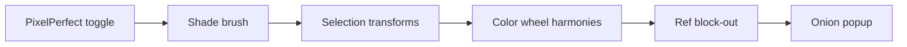

# Pixel editor features

Status: **in progress** — backlog for Aseprite-inspired upgrades in `pixel/`. Transforms + onion shipped; wheel / block-out still open.
Canonical tracked copy (git). Cursor agent plan may mirror this.

## Goal

Extend the Vite + Canvas 2D pixel editor with selection transforms (multi-algorithm resample), ref→pixel block-out, shade brushes, pixel-perfect strokes, color harmonies, and sheet-based onion skinning — without rewriting the document model.

Canonical app: [`pixel/`](../pixel/) — `Editor` + `Project` (RGBA layers, refs, sheet cells). Docs: [`pixel/README.md`](../pixel/README.md).

---

## What exists today (baseline)

| Area | Today | Hooks |
|------|--------|--------|
| Paint | Disc stamp + dense `walk_line` | [`pixel/src/paint.ts`](../pixel/src/paint.ts) |
| Selection | Rect/lasso → `FloatingSel` (translate only) | [`pixel/src/select.ts`](../pixel/src/select.ts), [`document.ts`](../pixel/src/project/document.ts) |
| Color | Native `<input type="color">` + hex + palette | [`pixel/src/ui/side.ts`](../pixel/src/ui/side.ts), [`color.ts`](../pixel/src/color.ts) |
| Refs | Display under pixels; not baked | `ReferenceLayer` in `document.ts` |
| “Animation” | Sheet grid + filmstrip + play popup | [`sheet.ts`](../pixel/src/ui/sheet.ts), [`preview.ts`](../pixel/src/ui/preview.ts) — **not** frame buffers |
| Undo | Snapshot stack | [`undo.ts`](../pixel/src/project/undo.ts) |

**Not implemented:** CV block-out. Pixel-perfect, ramp shade, transforms, onion skin, and HSV picker shipped.

---

## Feature briefs

### 1. Selection transforms (squash / stretch / rotate / flip)

**Goal:** Aseprite-like ops on the active floating selection (then optionally whole layer).

**Approach:** Extend `FloatingSel` with transform UI while floating is active:

- Flip H/V (exact remap; no resample)
- Rotate 90° / 180° / 270° (exact remap; no resample)
- Free rotate + scale / squash-stretch via corner handles → **resample into new bounds**, with a selectable algorithm (below)
- Hold modifier for uniform scale

Commit still goes through `stamp_floating` / `commit_floating`. Undo = existing snapshot stack.

**Modules:** `select.ts`, `document.ts` (`FloatingSel`), new `pixel/src/transform/` (remap + resample), transform chrome in `ui/` or overlay on canvas.

#### Resample modes (user-selectable; nearest is default)

Pixel-art transforms are taste-dependent. Expose a **Transform mode** dropdown (persisted per session / prefs), not a single hard-coded filter.

| Mode | Best for | Notes |
|------|----------|--------|
| **Nearest** (default) | Intentional pixel control, hard edges, palette purity | Fast; jagged at arbitrary angles; still often best for hand-tuned sprites |
| **Fast RotSprite** | Free rotation preview + commit | 3× upscale → rotate → 3× downscale; no new colors; good interactive quality/cost vs classic RotSprite. Use for **rotate**, not as the scale-only path |
| **RotSprite (full)** | Highest-quality free rotate on commit | Classic Xenowhirl path (Aseprite-style); heavier — OK on commit / small selections |
| **Scale2× / EPX family** | Integer upscales (2×, 4× via repeated) | Edge-preserving; no new colors; poor for arbitrary non-integer sizes |
| **2×SaI** (Super2×SaI if cheap) | Soft upscale / stretch | Can look mushy on hard pixel art; **not** universally better than nearest — option for organic shapes / ref cleanup |

**Practical wiring:**

- Live drag preview: **Nearest** or **Fast RotSprite** so handles stay responsive
- On commit: apply the selected mode once into the floating buffer
- Non-90° rotate: Fast RotSprite (or full RotSprite) as recommended options; nearest always available
- Arbitrary scale: nearest + 2×SaI (+ integer Scale2× when factor is exactly 2/4); do not force 2×SaI as default

**Out of v1:** skew, perspective, animated tween transforms, GPU shader ports (CPU/TS first is fine for editor-sized canvases).

---

### 2. Reference → pixel block-out (outline / fill)

**Goal:** From a background reference, create a new pixel layer at chosen `W×H` (or current canvas) with a blocked silhouette / edges.

**Approach (in-editor TypeScript, no Python service):**

1. Sample visible `ReferenceLayer`(s) into an offscreen canvas at target `W×H`
2. Pipeline (tunable): luminance / color quantize → threshold or k-means → optional Sobel/Canny-lite edges → flood fill solid regions
3. Write result into `Project.new_layer()` pixels; keep ref underneath for cleanup

UI: “Block out from refs…” dialog (size, threshold, edge vs fill, max colors).

**Modules:** new `pixel/src/blockout/` (or `cv/`), `document.ts` / project layer APIs, dialog in `ui/`.

**Why not Python first:** editor is Vite/TS; round-tripping files kills the Pencil workflow. A later `tools/ref_to_pixels.py` can exist for batch; primary path is browser-side.

**Out of v1:** ML segmentation, server-side CV, auto-palette matching beyond simple quantize.

---

### 3. Highlight / shadow brush

**Goal:** Shade without constantly picking colors.

**Two modes (plan):**

| Mode | Behavior |
|------|----------|
| **Ramp** (shipped) | Shade strip under palette: 3 darks · base · 3 lights. Click slots to pick colors; stroke steps toward Dark/Light |
| **Auto HSV** (shipped) | Per-pixel HSV value step (+ mild sat bias); optional snap to nearest project palette color. Best for mixed hues in one stroke |

Ink ops: read existing pixel → map → write (once per pixel per stroke; respects selection mask). Tool `U`; `,` / `.` set dark / light.

**Modules:** `paint.ts`, `color.ts` (`shade_hsv_step`, `shade_ramp_step`), `editor.ts` / `ui/side.ts`.

**Out of v1:** warm/cool hue-shift shading (Aseprite Color Shading.lua style), pressure curves.

---

### 4. Pixel-perfect drawing

**What it is (Aseprite):** While freehand-stroking at 1px, the stroke buffer records painted cells. When a new cell would form an **L-corner** (orthogonal jog of 1), the **middle corner pixel is removed** so diagonals stay a single-pixel staircase instead of a 2px-thick “chunky” corner.

```text
Without PP:     With PP:
  #               #
  ##               #
   #                #
```

**Not** fuzzy “tolerance” — a discrete rule on the last 2–3 pixels of the stroke. Toggle on/off (default off, or on for size=1 only). Larger brushes: disable PP or apply only to the brush center path.

**Implementation:** Stroke history list in `Editor` paint path; after each `walk_line` segment / plot, run corner-elimination before committing (or erase the redundant cell). Keep continuous mode for textured strokes.

**Modules:** `paint.ts`, `editor.ts`, toggle in `ui/tools.ts` or keys panel.

**Out of v1:** PP for non-1px brushes beyond center-path; vector stroke cleanup.

---

### 5. Color wheel + harmony suggestions

**Goal:** Replace/augment native color input with a wheel + harmony chips.

**Approach:**

- Add HSL/HSV helpers in [`color.ts`](../pixel/src/color.ts)
- Wheel (or square + hue slider) in side panel
- Harmonies from current color: complementary, analogous, triadic, tetradic, split-complementary — click chip → set `project.color` or add to palette
- Optional: “push harmony to palette” button

**Modules:** `color.ts`, `ui/side.ts`, possibly `palette.ts`.

**Out of v1:** full CIELAB picker, locked brand palettes, harmony animation.

---

### 6. Onion skinning (sheet-aware popup)

**Goal:** See neighboring sheet cells while editing the current cell — without a full frame-stack rewrite yet.

**Approach (fits current model):**

- Treat `SheetSettings` play cells as frames (regions of one canvas)
- Onion popup (same pattern as [`preview.ts`](../pixel/src/ui/preview.ts)): ghost blit prev/next N cells at tinted opacity, aligned to current cell
- Controls: ±frames, opacity, tint colors, above/below pixels

**Modules:** `ui/preview.ts` (pattern), new onion UI, `sheet.ts` / sheet settings, `render.ts` for blit.

**Later (not v1):** true per-frame layer stacks if sheet editing becomes too cramped.

---

## Suggested build order



1. **Pixel-perfect** — small; teaches stroke pipeline discipline
2. **Shade brush** — daily painting win
3. **Transforms** — unlocks cleanup of blocked-out art (ship nearest first; add Fast RotSprite / 2×SaI as mode options)
4. **Color wheel / harmonies** — UI-heavy, independent
5. **Ref block-out** — larger; unlocks tracing workflow
6. **Onion popup** — once sheet workflow is habitual

---

## Done when (implementation)

Per feature, treat as done when:

- [x] Pixel-perfect: toggle works on 1px freehand; L-corners eliminated; continuous mode still available
- [x] Shade brush: Ramp + Auto HSV (optional palette snap); respects selection mask; undoable; once-per-pixel per stroke
- [x] Transforms: flip / 90° exact; free rotate + scale with mode dropdown (nearest default + Fast RotSprite + at least one scale option); commit via floating stamp
- [ ] Color wheel: HSV helpers; wheel UI; harmony chips set color / palette
- [ ] Block-out: dialog → new layer from refs; threshold / edge vs fill tunable
- [x] Onion: preview ghosts ±N sheet cells with opacity/tint controls

This doc itself is done when linked from [`plans/README.md`](./README.md) and implementable without re-researching pixel-perfect or resample tradeoffs.
