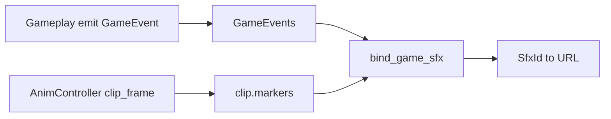

# Plan — Game events → SFX

Working brief: grow [`src/level_manager/events.ts`](src/level_manager/events.ts) + [`src/audio/game_sfx.ts`](src/audio/game_sfx.ts) so presentation can play sounds from **domain events** and later **anim-frame markers**, without gameplay importing `Audio`.

**In scope:** SFX only (enums, registries, domain→SFX, clip markers).  
**Out of scope here:** hitboxes, VFX, anim-clip switching via a cue bus. Frame-synced hurt volumes belong on anim/move data later — not on this bus.

Related: [`src/art/anim_def.ts`](src/art/anim_def.ts), [`src/art/anim_controller.ts`](src/art/anim_controller.ts), [`todo.md`](todo.md).

---

## What exists in code (read this first)

### Domain bus — `GameEvent`

```ts
// src/level_manager/events.ts
export type GameEvent =
    | { type: "actor_stomped"; actor: ContactBody }
    | { type: "player_hurt"; source: "actor_hazard" }
    | { type: "player_dash"; facing: number }
    | { type: "player_death"; reason: RestartReason.Death | RestartReason.Fall }
    | { type: "room_exit" }
    | { type: "lob_picked_up"; lob: Lob }
    | { type: "lob_thrown"; lob: Lob }
    | { type: "lob_hit_walker"; lob: Lob; walker: Walker }
    | { type: "lob_bounce_lob"; a: Lob; b: Lob };
```

`GameEvents` is a simple `Set` of listeners: `on` / `emit`. Gameplay emits; it does not subscribe.

| Event | Emitted from |
|-------|----------------|
| `player_dash` | `Player._try_dash` |
| `player_death` / `room_exit` | `PlayScene.restart_room` (before FX) |
| `actor_stomped`, `player_hurt`, lob_* | `actor_contacts` / `lob_interact` |

`RestartReason` (`Exit | Death | Fall | Manual`) lives in [`restart.ts`](src/level_manager/restart.ts). Manual restart does **not** emit death/exit.

### SFX listener today

```ts
// src/audio/game_sfx.ts — string path table, not an enum
const SFX = {
    dash: "/audio/dash2.flac",
    death: "/audio/raw/knifesharpener1.flac",
    exit: "/audio/raw/bird_poo.flac",
} as const;

// switch only handles player_dash | player_death | room_exit; default: no-op
```

Wired once in `World` via `bind_game_sfx(this._scene.events)`.

### Anim — no markers yet

```ts
// src/art/anim_def.ts
export type AnimClipDef = {
    frames: number[];  // sheet indices
    fps: number;
    loop?: boolean;
};
// AnimDef.clips: Record<string, AnimClipDef>  — clip ids are free strings
```

`AnimController` already exposes `clip_frame()` (index into `frames[]`) and `sheet_frame()`. (The demo anim this paragraph described has been removed; see the superseded note under "Clip markers".)

There is **no** `SfxId`, **no** clip markers, **no** `move_phase` event, **no** shared cue bus beyond `GameEvents`.

---

## Goals (SFX)

1. Gameplay stays emit-only — no `new Audio` in `player/`.
2. Prefer **enums + `Record<SfxId, …>`** over path strings in switches.
3. Two ways to trigger sound:
   - **Domain** — one-shot gameplay facts (`player_dash`, stomped, …).
   - **Clip markers** — sound at a specific `clip_frame` while an anim plays.
4. Stay cheap; exhaustive `switch` + `never` where we already do (e.g. `restart_room`).

Non-goals for this plan: RoomFx via bus, anim play cues, hitbox windows.

---

## Target shape



### `SfxId` + registry

```ts
enum SfxId {
    Dash = "dash",
    Death = "death",
    Exit = "exit",
    SlashWhoosh = "slash_whoosh",
    // add as needed — stomped, lob throw, …
}

const SFX_URL: Record<SfxId, string> = {
    [SfxId.Dash]: "/audio/dash2.flac",
    [SfxId.Death]: "/audio/raw/knifesharpener1.flac",
    [SfxId.Exit]: "/audio/raw/bird_poo.flac",
    [SfxId.SlashWhoosh]: "/audio/…", // pick file when authored
};
```

`bind_game_sfx` maps known `GameEvent["type"]` → `SfxId` (or ignores). Unknown events stay silent via `default: break` or an explicit allowlist.

### Clip markers (extend `AnimClipDef` only for SFX)

> **Superseded.** Anim v2 puts `events: string[]` on each frame instead of a `markers` list. `AnimController` fires a frame's events when it enters that frame (walking every frame a large `dt` crosses), the player animator re-emits each as `{ type: "anim_event"; name }` on `GameEvents` in [`src/level_manager/events.ts`](src/level_manager/events.ts), and `bind_game_sfx` maps names to sounds through its `ANIM_SFX` table. The sketch below is kept for history.

```ts
/** One-shot when clip_frame first reaches `at` this play-through. */
type AnimSfxMarker = {
    at: number;   // index into clip.frames[], not sheet cell
    sfx: SfxId;   // JSON: same string as enum value; normalize or throw
};

export type AnimClipDef = {
    frames: number[];
    fps: number;
    loop?: boolean;
    markers?: AnimSfxMarker[];
};
```

Flush after `AnimController.update`: for markers with `at` in `(prev_frame, frame]`, call the same `play_sfx(SFX_URL[m.sfx], …)` path. Multi-frame dt jumps must flush the range, not only equality on `frame`.

Clip ids stay strings for now (`Record<string, AnimClipDef>`); introducing `AnimClipId` can wait until actors actually switch clips from code.

---

## Definitive example — whoosh on slash frame 1

**Domain:** when strike starts, gameplay may later emit something richer; today nothing pogo-specific is on the bus. For SFX-at-frame we only need the clip playing and markers.

**Authored clip** (once a real slash sheet exists):

```json
"slash_down": {
  "frames": [0, 1, 2, 3],
  "fps": 12,
  "loop": false,
  "markers": [
    { "at": 1, "sfx": "slash_whoosh" }
  ]
}
```

| clip_frame | Marker |
|------------|--------|
| 0 | — |
| 1 | `SfxId.SlashWhoosh` |
| 2–3 | — |

**Runtime:** presentation owns flush; gameplay never calls `play_sfx` for the whoosh. Connect/stomp impact SFX (if wanted) stays on existing domain `actor_stomped`, not a frame marker.

---

## Domain → SFX map (evolve `bind_game_sfx`)

Today:

| `GameEvent.type` | Sound |
|------------------|--------|
| `player_dash` | dash |
| `player_death` | death |
| `room_exit` | exit |
| everything else | silent |

Next easy wins (still domain, no markers): `lob_thrown`, `actor_stomped`, `player_hurt` → new `SfxId`s when assets exist.

Do **not** invent `move_phase` / VFX / anim cues in this plan unless a sound has no other hook — prefer markers for mid-clip beats.

---

## Suggested build order

1. Introduce `SfxId` + `SFX_URL`; rewrite `bind_game_sfx` to use them (behavior unchanged).
2. Optional: map a few more existing `GameEvent`s once files are in `assets/audio/`.
3. Extend `AnimClipDef` + `normalize_anim` with optional `markers`; reject unknown `sfx` keys.
4. Flush markers from wherever `AnimController.update` already runs (preview / play) — shared helper, one play path.
5. Author a real clip with a marker when slash (or demo) art is ready.

---

## Done when

- No raw path strings inside the `GameEvent` switch — only `SfxId` → URL.
- A clip can fire an SFX at a given `clip_frame` via JSON `markers`.
- Hitboxes / VFX / clip-switching are **not** smuggled into this bus.
