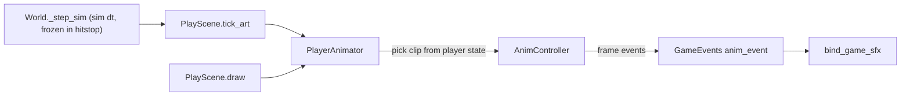

# Player animations and parallax backgrounds

## 1. Remove the demo animation

- Delete `assets/art/demo/` (`demo.png`, `demo.anim.json`) and [tools/gen_demo_art.ts](tools/gen_demo_art.ts). Drop the `gen:art` script from `package.json`.
- Regenerate [assets/art/index.json](assets/art/index.json) with an empty `anims` list.
- [src/game/play_scene.ts](src/game/play_scene.ts): remove `_art_preview`, `load_art_preview` and `_draw_art_preview`. `tick_art` stays and will drive the new player animator.
- [src/world.ts](src/world.ts): remove both `load_art_preview()` calls in `init`.
- [README.md](README.md): remove the "Demo sprite smoke-test" line.
- Keep the anim panel and upgrade it to the new format (step 5).

## 2. Anim format v2 (game-side JSON, one per character)

An anim set lives at `assets/art/<set>/<set>.anim.json`, the same place the index already scans. Each clip can point at its own pixel-editor PNG, because the pixel editor exports one PNG per doc (for example `old_man_p_run.png` and `old_man_pogo.png`). Set-level `sheet`, `frame_w`, `frame_h` and `columns` act as defaults.

```json
{
  "version": 2,
  "id": "old_man",
  "origin_x": 64, "origin_y": 128,
  "scale": 0.25,
  "clips": {
    "run": {
      "sheet": "/art/old_man_p_run/old_man_p_run.png",
      "frame_w": 128, "frame_h": 128, "columns": 1,
      "fps": 8,
      "loop": true,
      "frames": [
        0,
        { "cell": 1, "duration": 0.06, "events": ["footstep"] },
        2,
        { "cell": 5, "events": ["footstep"] }
      ]
    }
  }
}
```

- A frame is either a bare cell number or `{ cell, duration?, events? }`. `duration` is in seconds. Clip `fps` is only the default duration, `1/fps`.
- `normalize_anim` in [src/art/anim_def.ts](src/art/anim_def.ts) turns every frame into `{ cell, duration, events: string[] }`. It rejects `duration <= 0`. Only v2 is accepted, since the demo was the only v1 file.
- `LoadedAnim` carries one loaded sheet per clip ([src/art/loader.ts](src/art/loader.ts), with shared image caching). [src/art/draw.ts](src/art/draw.ts) draws a frame using its clip's sheet, then applies the set's `scale` and `origin`.

## 3. AnimController rewrite: durations and frame events

In [src/art/anim_controller.ts](src/art/anim_controller.ts):

- State is a frame index plus time spent in that frame. `update(dt)` loops while the time exceeds the current frame's `duration`. It advances frame by frame, so a large `dt` still passes through, and fires, every frame in between.
- Entering a frame fires its `events`. That includes frame 0 on `play()` and on each loop wrap. Non-looping clips stop on their last frame and call `on_end`.
- Hooks: `on_event?: (name: string, clip: string, frame: number) => void` and `on_end?: (clip: string) => void`.
- Frame events are presentation only, such as sounds and dust. Hitboxes stay in gameplay code, which matches [plans/plan-game-events.md](plans/plan-game-events.md).
- Bus wiring: the player animator re-emits each frame event as `{ type: "anim_event"; name: string }` on `GameEvents` ([src/game/events.ts](src/game/events.ts)). [src/audio/game_sfx.ts](src/audio/game_sfx.ts) looks names up in a table (for example `footstep` maps to a sound). Unknown names warn once.



## 4. PlayerAnimator

- New [src/player/animator.ts](src/player/animator.ts), owned by `PlayScene`:
  - `CharacterDef` gets an optional `anim` set id ([src/player/characters.ts](src/player/characters.ts)).
  - The animator loads that set and picks a clip from player state each tick: idle, run, jump, fall and dash, plus ability clips such as pogo `strike_down`, `strike_side` and `strike_up`, and grappler `grapple`.
  - A missing clip falls back along a chain (fall, then jump, then idle).
  - With no set, or before it loads, the current rectangle drawing stays.
- Ticked from `tick_art`, which runs on sim dt. Animations therefore freeze during hitstop and follow the time scale.
- Drawing: the sprite is flipped by `facing` and pivoted at the bottom-center of the body. `Player.draw` gains a `body` option, so the rectangle only draws when there's no sprite. Ability visuals like the pogo slash hitbox and grapple rope still draw either way. Debug mode keeps a hitbox outline.
- First authored set: `old_man` for the Pogo character, using `old_man_p_run` as `run` and `old_man_pogo` as the strike or idle pose.

## 5. Anim panel upgrade

- [tools/vite-level-save.ts](tools/vite-level-save.ts): the art index also lists `sheets`, meaning art folders that have an `<id>.png`. The dev server reads each `.pixel.json` `sheet` block for `frame_w`, `frame_h`, `columns`, `fps` and `play`, so the game never loads the multi-megabyte pixel docs.
- [src/editor/gui/anim_panel.ts](src/editor/gui/anim_panel.ts) and the host in [src/editor/editor.ts](src/editor/editor.ts):
  - A sheet picker per clip, with "Import from pixel doc" that fills frame size, columns, fps and the frame list.
  - A frame list where each row has a cell, a duration in seconds and a comma-separated events field.
  - The preview uses the new controller and briefly shows event names as they fire.
- `empty_anim_document` produces a v2 document.

## 6. Parallax backgrounds: a list of PNG layers

Backgrounds are defined in `assets/backgrounds/<id>.json`. Layer images come from the pixel editor's upcoming per-layer export, for example `assets/art/eroded_earth/layers/sky.png`. Until then, the flattened `eroded_earth.png` works as a single layer.

```json
{
  "version": 1,
  "id": "eroded_earth",
  "clear": "#1a2740",
  "layers": [
    { "image": "/art/eroded_earth/layers/sky.png", "scroll": [0, 0], "anchor": "view" },
    { "image": "/art/eroded_earth/layers/building_hrzn.png", "scroll": [0.2, 0.1], "anchor": "bottom", "repeat_x": true },
    { "image": "/art/eroded_earth/layers/near_building_silhouette.png", "scroll": [0.6, 0.4], "anchor": "bottom", "repeat_x": true, "velocity": [0, 0], "effects": [] }
  ]
}
```

Per-layer settings, all optional except `image`:

- `scroll`: the parallax factor per axis. 0 pins the layer to the screen, 1 moves it with the world.
- `anchor`: `view`, `top` or `bottom` (of the level). This decides what `offset` is measured from.
- `offset`: art-pixel offset from the anchor.
- `velocity`: auto-scroll in pixels per second, for clouds.
- `repeat_x` and `repeat_y`: tile the image across the view.
- `scale`: art pixels per world pixel.
- `opacity`, and `blend`, which is a canvas composite operation.
- `effects`: a list of `{ shader, params }` entries. These are parsed and stored now but not run.

Hooking it up:

- [src/level/room_document.ts](src/level/room_document.ts): add an optional `background?: string` to `RoomDocument`. It's editable in the room JSON; an editor dropdown is a later follow-up.
- New `src/background/` module:
  - `background_def.ts`: types and `normalize_background`.
  - `loader.ts`: fetches the JSON and caches images.
  - `placement.ts`: a pure function `layer_placement(layer, view, time)` that returns screen rects, including repeat tiles, rounded to whole pixels.
  - `renderer.ts`: the renderer interface and the Canvas2D implementation.

### Shader-ready renderer

```ts
interface BackgroundRenderer {
    draw(ctx: CanvasRenderingContext2D, bg: LoadedBackground, view: BackgroundView, time: number): void;
}
type BackgroundView = { cam_x: number; cam_y: number; scale: number; view_w: number; view_h: number; level_w: number; level_h: number };
```

- `Canvas2DBackgroundRenderer` handles `opacity` and `blend`. For `effects`, it skips them and warns once per shader name.
- A future `WebGLBackgroundRenderer` can reuse the same `layer_placement`. It would upload the layer images as textures, run each layer's `effects` as fragment passes with `time` and `params` as uniforms on an offscreen WebGL canvas, and composite the result with `ctx.drawImage`. Layout math, JSON and call sites stay the same.
- [src/world.ts](src/world.ts) `draw()`: draw the background in screen space after the shake translate but before `camera.apply_transform`. It replaces the sky gradient, which remains the fallback when a room has no background or it hasn't loaded. `World` loads the background in `load_room` and also draws it in edit mode.

## Docs

- Update the README art section to cover the anim set and background JSON locations.
- In [plans/plan-game-events.md](plans/plan-game-events.md), mark the clip-markers section as superseded by frame `events` plus `anim_event`.
